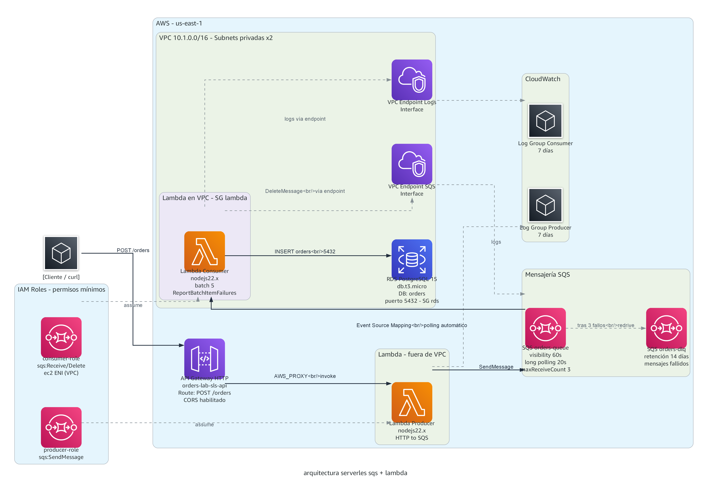

# Lab: Serverless (Lambda + SQS) vs Server-full (EC2 directo) — Escrituras a RDS

## Objetivo

Demostrar la **resiliencia de SQS** comparando dos arquitecturas que escriben a la misma base de datos (RDS PostgreSQL):

1. **¿Qué pasa cuando RDS se cae?** — Con SQS los mensajes esperan. Sin SQS, se pierden.
2. **¿Qué pasa con picos de escritura?** — SQS absorbe el pico. Sin SQS, saturamos el connection pool.
3. **¿Cuánto cuesta cada enfoque?** — Serverless ~$0 en reposo vs EC2+RDS siempre encendidos.

## Arquitectura

### Serverless (Lambda + SQS + RDS)

```
Clientes ──→ API Gateway ──→ Lambda Productor ──→ SQS Queue ──→ Lambda Consumidor ──→ RDS
                                                       ↓ (tras N fallos)
                                                   Dead Letter Queue
```




- SQS actúa como **buffer resiliente** entre la petición y la escritura a DB
- Si RDS se cae: mensajes quedan en SQS, se procesan cuando vuelva
- Si Lambda falla: SQS reintenta automáticamente
- Picos de tráfico: SQS absorbe sin límite, Lambda escala el consumo gradualmente

### Server-full (EC2 + RDS directo)

```
Clientes ──→ EC2 (Express, IP pública) ──→ RDS directamente
```

- Sin cola intermedia — escritura síncrona directa a la base de datos
- Si RDS se cae: error 500, la escritura se pierde
- Picos de tráfico: connection pool se agota, requests fallan

## Estructura del Proyecto

```
├── serverless/
│   ├── terraform/
│   │   ├── main.tf              # Provider AWS
│   │   ├── variables.tf         # Variables configurables
│   │   ├── outputs.tf           # URLs y ARNs útiles
│   │   ├── lambda.tf            # Lambdas (productor + consumidor)
│   │   ├── sqs.tf               # Cola SQS + DLQ
│   │   ├── api_gateway.tf       # API Gateway HTTP
│   │   ├── rds.tf               # RDS PostgreSQL (compartida)
│   │   ├── iam.tf               # Roles IAM
│   │   ├── checker.tf           # Lambda de verificación (consulta RDS en VPC)
│   │   └── verify.ps1           # Script de verificación de recursos desplegados
│   └── src/
│       ├── producer/index.js    # Recibe request → envía a SQS
│       ├── consumer/index.js    # Lee de SQS → escribe en RDS
│       └── checker/index.js     # Consulta la tabla orders en RDS (solo lectura)
│
├── server-full/
│   ├── terraform/
│   │   ├── main.tf              # Provider AWS
│   │   ├── variables.tf         # Variables configurables
│   │   ├── outputs.tf           # IP pública, endpoint RDS
│   │   ├── vpc.tf               # VPC simple (1 subnet pública)
│   │   ├── ec2.tf               # 1 EC2 pública con Express
│   │   └── rds.tf               # RDS PostgreSQL
│   │   └── userdata/
│   │       └── api.sh           # Bootstrapping de la instancia
│   └── src/
│       └── server.js            # Express → escribe directo a RDS
│
├── load-test.k6.js             # Prueba de carga con k6 (1000 req concurrentes)
├── load-test.ps1               # Prueba de carga alternativa en PowerShell nativo
├── hello-k6.js                 # Test de práctica de k6 (contra sitio público)
├── check-db.ps1                # Verifica datos en RDS vía Lambda checker
└── README.md
```

## Pruebas de Carga con k6

Las pruebas de carga del lab usan [k6](https://k6.io/), una herramienta de código
abierto (Grafana) para medir latencia, throughput y tasa de errores bajo carga
concurrente. El test está definido en `load-test.k6.js`.

### Instalar k6

```powershell
# Windows (winget)
winget install GrafanaLabs.k6

# o Chocolatey
choco install k6
```

Alternativa portable (sin instalador): descargar el binario desde las
[releases de k6](https://github.com/grafana/k6/releases) y agregarlo al PATH.

### Conceptos clave

- **VUs (Virtual Users)**: usuarios virtuales que ejecutan la prueba en paralelo. Definen la concurrencia.
- **p(95)**: el 95% de los requests respondió por debajo de este valor. Más fiable que el promedio.
- **http_req_failed**: porcentaje de requests fallidos. En este lab = **órdenes perdidas**.

### Test 1: Pico de escrituras concurrentes (1000 requests)

El script acepta la URL destino y la concurrencia por variables de entorno:

```powershell
# Serverless (con SQS) — 1000 requests, 50 usuarios virtuales
$env:TARGET_URL = "https://<api-gateway-url>/orders"
$env:VUS = "50"
$env:TOTAL = "1000"
k6 run load-test.k6.js

# Server-full (EC2 directo)
$env:TARGET_URL = "http://<ec2-public-ip>:3000/orders"
k6 run load-test.k6.js
```

**Resultado esperado:**

| Arquitectura | http_req_failed | Comportamiento |
|---|---|---|
| Serverless (SQS) | ~0% | El productor solo encola; SQS absorbe el pico sin pérdidas |
| Server-full (directo) | sube al saturar | Al pasar de 10 conexiones (pool), aparecen 500 → **órdenes perdidas** |

> Un `2xx` en el serverless significa "encolado", no "guardado en RDS". Para confirmar
> que las órdenes llegaron a la base de datos, usa `check-db.ps1` (ver más abajo).

### Práctica: primer contacto con k6

Si es tu primera vez con k6, `hello-k6.js` corre contra el sitio público de pruebas
de Grafana (no toca tu infraestructura) y está comentado como mini-tutorial:

```powershell
k6 run hello-k6.js
```

### Alternativa sin k6: prueba de carga en PowerShell

`load-test.ps1` hace lo mismo con runspaces nativos (sin instalar nada):

```powershell
.\load-test.ps1 -Url "https://<api-gateway-url>/orders" -Requests 1000 -Concurrency 50 -Label serverless
```

### Alternativa con Apache Bench (Linux/WSL)

```bash
ab -n 1000 -c 100 -p payload.json -T "application/json" https://<api-gateway-url>/orders
```

### Test 2: Simular caída de RDS
```bash
# Detener RDS temporalmente desde la consola AWS o CLI
aws rds stop-db-instance --db-instance-identifier orders-lab-db

# Enviar requests a ambos endpoints y observar:
# - Serverless: 202 Accepted (mensajes quedan en SQS esperando)
# - Server-full: 500 Error (escrituras perdidas)

# Reactivar RDS
aws rds start-db-instance --db-instance-identifier orders-lab-db
# Serverless: mensajes en SQS se procesan automáticamente
```

### Test 3: Ver la DLQ en acción
```bash
# Revisar mensajes en Dead Letter Queue (mensajes que fallaron 3 veces)
# --visibility-timeout 0 para inspeccionar sin consumir
aws sqs receive-message --queue-url <dlq-url> --max-number-of-messages 10 --visibility-timeout 0
```

### Test 4: Redrive — recuperar mensajes de la DLQ

Una vez corregida la causa de los fallos del consumidor, los mensajes de la DLQ
se devuelven a la cola principal para reprocesarlos (ninguna orden se pierde):

```powershell
$dlqArn = "arn:aws:sqs:<region>:<account-id>:orders-lab-sls-orders-dlq"

# Mover mensajes de la DLQ de vuelta a su cola de origen
aws sqs start-message-move-task --source-arn $dlqArn

# Ver el progreso del movimiento
aws sqs list-message-move-tasks --source-arn $dlqArn
```

## Verificación de Datos en RDS

RDS está en subnets **privadas**, inaccesible desde fuera de la VPC. Para confirmar
que las órdenes realmente llegaron a la base de datos, el lab incluye una **Lambda
checker** (`serverless/src/checker/`) que vive dentro de la VPC y ejecuta consultas
de solo lectura sobre la tabla `orders`.

```powershell
# Invoca la Lambda checker y muestra el conteo, desglose por status y últimas órdenes
.\check-db.ps1
```

Salida de ejemplo:

```
TOTAL de ordenes en RDS: 2001
Desglose por status:
  processed      2001
```

Esto cierra el ciclo de verificación: k6 confirma que las órdenes se **aceptaron**,
y `check-db.ps1` confirma que se **persistieron** en RDS.

> 📄 Para el caso real donde el consumidor fallaba (módulo `pg` faltante), cómo se
> diagnosticó, el redrive de la DLQ y la Lambda checker, ver
> [`docs/troubleshooting-pg-dlq-redrive.md`](docs/troubleshooting-pg-dlq-redrive.md).
> Los conceptos de k6 están en [`docs/k6-explication.md`](docs/k6-explication.md).

### Verificar los recursos desplegados

```powershell
# Inventario de recursos (Terraform + estado real en AWS)
cd serverless/terraform
.\verify.ps1
```

## Costos Estimados (us-east-1)

| Recurso | Serverless | Server-full |
|---------|-----------|-------------|
| Compute | Lambda: $0 en reposo | EC2 t3.micro: ~$8/mes |
| Base de datos | RDS db.t3.micro: ~$13/mes | RDS db.t3.micro: ~$13/mes |
| Cola/Buffer | SQS: ~$0.40/millón msgs | N/A (no tiene) |
| API | API Gateway: ~$1/millón req | Incluido en EC2 |
| Networking | Mínimo | VPC + IP pública: ~$4/mes |
| **Total (reposo)** | **~$13/mes** (solo RDS) | **~$25/mes** |
| **Total (tráfico bajo)** | **~$14/mes** | **~$25/mes** |

## Despliegue

```bash
# Serverless
cd serverless/terraform
terraform init && terraform apply

# Server-full
cd server-full/terraform
terraform init && terraform apply
```

## Limpieza

```bash
cd serverless/terraform && terraform destroy
cd server-full/terraform && terraform destroy
```
